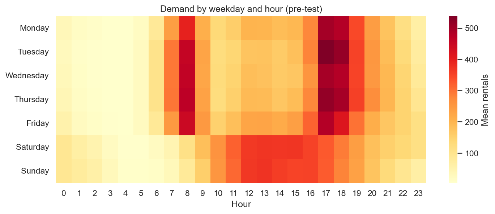

# Bike Rental Demand Prediction

**Live application:** [Cyclecast — case study and forecast lab](https://169.58.96.231/bike-rentals/) · [API documentation](https://169.58.96.231/bike-rentals/docs)

Predict next-hour bike rentals with Python, pandas and scikit-learn using the UCI Bike Sharing dataset.

The active modelling workflow uses **one algorithm: Histogram Gradient Boosting regression**. It includes causal feature engineering, feature-set selection, chronological `GridSearchCV`, saved predictions and a complete fitted pipeline. The FastAPI backend and React/TypeScript frontend are implemented and tested. VPS hosting uses a Python virtual environment, systemd and Nginx, matching the existing applications.

## Current validation results

| Measure | Selected model |
| --- | ---: |
| Mean fold MAE | 31.60 rentals/hour |
| Mean fold RMSE | 50.08 rentals/hour |
| Mean fold R² | 0.9543 |
| Predictions within ±50 rentals | 80.46% |
| Predictions within ±20% of actual demand | 74.55% |

These are development-validation results over 2,016 hours, from folds also used for parameter selection. They are **not final-test scores or classification accuracy**. The selected configuration improves mean validation MAE modestly over untuned HGB: 32.07 → 31.60 (1.45%).

## Final test results

The frozen pipeline has now been evaluated on 3 October–31 December 2012 without retraining or tuning. All comparisons use the same 2,076 eligible hours (97.92% of 2,120 observed targets).

| Predictor | MAE | RMSE | R² |
| --- | ---: | ---: | ---: |
| Selected HGB pipeline | **27.12** | **42.67** | **0.9551** |
| Previous-week rule | 70.38 | 117.08 | 0.6620 |
| Previous-hour rule | 76.13 | 118.90 | 0.6514 |

HGB is within ±50 rentals on 83.77% of scored test hours and within ±20% of actual demand on 67.34%. Its lower test MAE but lower relative-tolerance rate than validation illustrates that these measures answer different questions; periods have different demand distributions. See the [final test report](outputs/reports/final_test_report.md) for coverage, plots, hashes and limitations. This holdout is now used and must not become a tuning target.

- [Grid-search settings and results](outputs/reports/hgb_grid_search.md)
- [How the model learned](outputs/reports/hgb_learning.md)
- [Actual prediction examples and errors](outputs/reports/validation_closeness.md)
- [All candidate scores](outputs/experiments/hgb_grid_search/cv_results.csv)

## Prediction contract

After hour **t** ends and its count is available, predict the total rentals during **t + 1**. The target is `cnt`. Rows are indexed by the hour being predicted.

For a prediction covering 18:00–18:59, the most recent observation is from 17:00–17:59. The request contains only known target-calendar flags and demand from the previous 168 hourly positions. Missing hours remain unknown, never automatically zero.

The pipeline creates:

| Input family | Features |
| --- | --- |
| Calendar | Hour, weekday, month, weekend, holiday, working day |
| Calendar cycles | Sine/cosine encodings of hour, weekday and month |
| Trend | Days since 2011-01-01 |
| Demand history | Lags of 1, 2, 24, 48 and 168 hours |
| Shifted summaries | Prior 24-hour and 168-hour means and standard deviations |

No target count enters its own features. `casual` and `registered` are excluded because they sum to the target. `instant` is excluded as a record identifier. Target-hour observed weather is excluded because it is unavailable at prediction time. Calendar flags assume an advance holiday calendar.

See the [model guide](model/README.md) for the code map, four commands and interview walkthrough.

## One complete modelling workflow

```text
Download hourly data
  → audit timestamps, explore pre-test data and freeze the split
  → package past observations for each target hour
  → GridSearchCV over one complete sklearn pipeline
      features → feature-set selection → preprocessing → HGB → nonnegative count
  → refit the winner on development data and save it
  → inspect out-of-fold predictions and learning progress
```

Request packaging preserves the hourly timeline and does not learn parameters. Each request has a target-hour DatetimeIndex and exactly `holiday`, `workingday` and `demand_history` columns. History contains t−168 through t−1, oldest first; NaN marks unknown hours, and the latest completed count must be available.

Feature selection compares calendar + lags against calendar + lags + rolling summaries. Grid search selects this feature set along with model parameters. Encoding, numeric median imputation and scaling are fitted separately inside every fold. The selected features, preprocessing and regressor are saved together. Grid search runs during training, not when serving a prediction.

| Hyperparameter | Searched values | Selected |
| --- | --- | --- |
| Feature set | Calendar + lags; calendar + lags + rolling | Calendar + lags + rolling |
| Learning rate | 0.05, 0.1 | 0.1 |
| Boosting iterations | 100, 200 | 200 |
| Maximum leaves | 15, 31 | 31 |
| L2 regularization | 0, 1 | 1 |

This is 32 configurations × 3 folds = 96 CV fits, followed by refitting and diagnostic fits. `min_samples_leaf=20`, seed 42 and `early_stopping=False` remain fixed. Search runs serially with two computation threads. Selection minimizes mean fold MAE using sklearn's `neg_mean_absolute_error` scorer. Its `mean_test_score` column means CV validation, not our held-out final test.

## Application: case study and forecast lab

The frontend walks through the problem, data quality, EDA, feature availability, initial comparison, grid search, learning curves and final-test results in eight chapters. Its forecast lab calls the actual saved model for five clearly labelled historical replay scenarios; advanced users can submit a validated custom request. All chart values and outcomes come from recorded experiment artifacts. Business value is presented as an editable planning-time scenario, not a claim of measured client profit.

For a fresh clone, first complete the **Run locally** model workflow below. The fitted model and raw dataset are excluded from Git; training and evaluation generate the matching artifacts needed by the API. If your fitted model already exists, continue here.

With your Python venv active, run from the repository root:

```bash
python -m pip install -r backend/requirements.txt
python backend/scripts/export_content.py
python -m uvicorn backend.app.main:app --host 127.0.0.1 --port 8003
```

In a second terminal:

```bash
cd frontend
npm ci
npm run dev
```

Open `http://127.0.0.1:5173/bike-rentals/`. Model training is not required when the saved artifact already exists. The exporter needs the completed local experiments; deployed inference uses only the small exported assets and fitted pipeline.

- [Backend code and API contract](backend/README.md)
- [Frontend development and browser tests](frontend/README.md)
- [Model workflow and interview walkthrough](model/README.md)

Runtime flow: browser → FastAPI validation → saved feature/preprocessing/HGB pipeline → prediction. Model loads once; no grid search or retraining happens during requests.

```bash
python -m pytest -c backend/pytest.ini backend/tests
cd frontend
npm run build
npx playwright install chromium
npm run test:e2e
```

The application is live at `https://169.58.96.231/bike-rentals/`. It runs from `/home/deploy/apps/bike-rentals` with a Python venv, one Uvicorn worker, systemd and Nginx. There are no Docker files or deployment folders. The public health endpoint was verified on 25 October 2026.

## Run locally

Use Python 3.11. From the repository root in Git Bash on Windows:

```bash
py -3.11 -m venv .venv
source .venv/Scripts/activate
python -m pip install -r model/requirements-lock.txt
```

If the environment already exists and is active, start with the install command. The lock file records the Windows reference environment. On Linux/macOS, create with `python3.11 -m venv .venv`, activate with `source .venv/bin/activate`, and install `model/requirements.txt` instead; the full lock contains Windows-specific packages.

```bash
# Download once; preserve archive and provenance.
python model/scripts/prepare.py

# Run the complete one-model workflow: search, save, prediction and learning reports.
python model/scripts/train.py

# Check leakage, chronological folds, pipeline serialization and diagnostics.
python -m pytest -c model/pytest.ini model/tests

# Regenerate prediction plots/reports from saved CV predictions without rerunning search.
python model/scripts/evaluate.py --split validation

# Score the frozen saved pipeline on the reserved chronological test, without fitting.
python model/scripts/evaluate.py --split test

# Open the exploration notebook.
python -m jupyterlab model/notebooks/01_exploration.ipynb
```

Training prints timestamped stages and each completed CV fit's parameters, scores and duration. CV scores are negative MAE internally: closer to zero is better. Final reports show positive MAE. Learning-curve logs show progress every 50 trees. The default two-thread CPU budget is configured in `config.py`, including joblib's CPU limit to avoid Windows physical-core detection warnings; no environment-variable prefix is required.

The only active saved model is `outputs/models/tuned_forecast_pipeline.joblib`. Custom classes under `model/src` must be importable when loading it. The provided prediction CLI handles the source path and complete feature pipeline:

```bash
python model/scripts/predict.py --history data/past_counts.csv --target "2012-10-03T00:00:00" --holiday 0 --workingday 1
```

Provide a CSV with `timestamp,cnt` columns, including only observations before the target. `make_forecast_request` aligns the prior week and rejects target/future observations. The command predicts one hour and does not score it; later requests need newly observed demand.

## Understand the learning and predictions

`08_hgb_learning_progress.png` plots MAE after each boosting tree, averaged across the three folds. The training curve describes examples used to fit each fold's model; the validation curve describes later hours. HGB optimizes squared error, so monitored MAE need not decrease at every iteration. The plot diagnoses a fixed selected configuration; it does not perform another parameter search.

`06_validation_actual_vs_predicted.png` shows the first seven validation days. Close overlap means close predictions. `07_validation_scatter_and_error_coverage.png` includes every validation hour: points on the diagonal are perfect predictions, and points below it are underpredictions. The error-coverage curve shows how often errors stay within a chosen rental-count tolerance.

The first 24 validation predictions, selected by date rather than performance, are in `outputs/experiments/hgb_grid_search/prediction_examples.csv`. Largest misses are saved separately. Error summaries cover hour, weekday and demand band; demand-band thresholds come only from each fold's training target.

These are rolling one-hour-ahead predictions, not a whole week forecast at one origin. Earlier validation observations supply history for later validation predictions, while model parameters stay fixed within each fold. The final pipeline refitted on all development data is not used to manufacture validation scores.

## Time split and missing data

- Source file: 17,379 observed hours during 2011–2012; 165 absent hourly timestamps.
- Development ends just before 2012-10-03 00:00. EDA demand/weather plots use this period only.
- Final test: 2012-10-03 00:00 through 2012-12-31 23:00; evaluated after model selection.
- Expanding validation blocks start 2012-07-11, 2012-08-08 and 2012-09-05 and last 28 days each.
- Training uses earlier eligible targets. The first week supplies history before the first eligible training target.
- An eligible row has observed target demand, previous-hour demand and previous-week demand. This fixed coverage rule preserves comparability with the earlier weekly benchmark. Other missing historical features are imputed inside the fitted pipeline.



See the [EDA notebook](model/notebooks/01_exploration.ipynb) and [feature rationale](outputs/reports/eda_findings.md). Temperature plots use normalized units because the archive README and current UCI metadata disagree on the Celsius conversion.

## Repository structure

```text
model/
  README.md                    # code map and interview walkthrough
  scripts/                     # prepare, train, evaluate, predict
  src/bike_demand/              # data, pipeline, preprocessing, training, evaluation
    analysis/                  # EDA, prediction diagnostics, learning curves
  notebooks/                   # exploration
  tests/                       # data, pipeline, training and evaluation checks
  requirements.txt
  requirements-lock.txt
data/                          # downloaded/processed files (ignored)
outputs/                       # metrics, parameters, reports and figures
  models/                      # one saved pipeline (ignored)
backend/                       # FastAPI routes, schemas, inference service and public assets
frontend/                      # React/TypeScript case study and forecast lab
```

Small reference metrics, figures and reports are versioned. Data, environments, models and full per-hour prediction exports are ignored and can be rebuilt. Earlier comparison scores in `outputs/experiments/initial_fixed_settings/` are historical references only; active code does not depend on them.

## Limitations and remaining work

Selection folds cover July through early October rather than every season, and their scores can be optimistic after grid search. The data is one historical city system. Immediate demand availability, timezone-naive hour labels and holiday-calendar availability are assumptions. Large peak-hour errors deserve attention even when average MAE is low.

The selected configuration was frozen before final-test evaluation. Keep the resulting score as a final assessment rather than tuning against it. The API and frontend are implemented and tested. The app is running on the VPS in a standard directory layout with systemd and Nginx. See `backend/README.md` for restart commands, logs and health checks.

## Dataset attribution

[UCI Bike Sharing](https://doi.org/10.24432/C5W894), contributed by Hadi Fanaee-T, contains hourly and daily Capital Bikeshare counts for Washington, DC in 2011–2012. UCI lists the dataset under [CC BY 4.0](https://creativecommons.org/licenses/by/4.0/). We use `hour.csv`; the downloader retains the archive and README locally and records source URL, download date and SHA-256 checksum.

The archive requests citation of Fanaee-T, Hadi, and Gama, Joao. “Event labeling combining ensemble detectors and background knowledge.” *Progress in Artificial Intelligence* (2013). [doi:10.1007/s13748-013-0040-3](https://doi.org/10.1007/s13748-013-0040-3).
